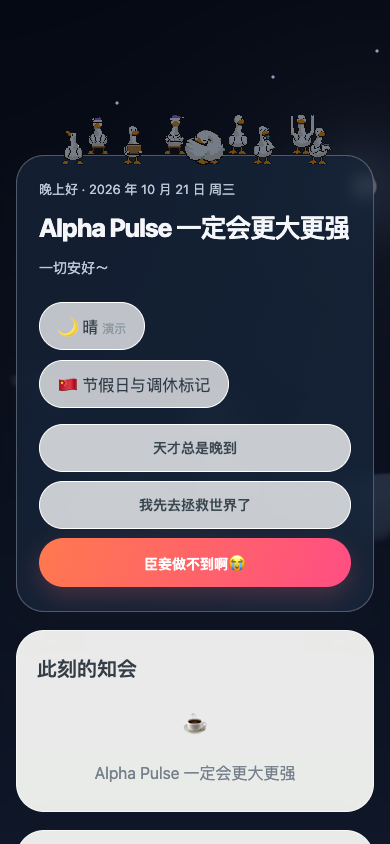

# 鸭鸭日历 v3.2.1｜首页文案与版本知会

**更新日期：**2026 年 10 月 21 日  
**范围：**首页空状态文案、版本更新说明的企业内私聊通知。  
**类型：**体验优化与发布流程补全。

## 为什么要改

首页无进行中知会时，原来的两句话偏解释性；而每次更新虽有完整的飞书文档，员工需要主动打开文档才会知道新版改了什么。我们希望首页更有团队语气，也让更新说明像常见产品版本公告一样，简短可读、可一键查看详情。

## 修改思路与实现

1. **首页文案。**无进行中知会时，主标题及空卡片统一改为“Alpha Pulse 一定会更大更强”，副标题改为“一切安好～”。同步修改静态首屏与数据加载后的渲染文案；知会判断和请假、晚到、提前离开登记逻辑不变。
2. **版本通知。**新增仅“版本通知管理员”可用的发布入口：输入版本号和最多 5 条亮点，先核对企业内部员工总数，再由妙搭助手向每人私聊发送“鸭鸭日历发布新版本-更新说明”。消息只放简要变化与[完整更新日志](https://ycn3zdw6f1p7.feishu.cn/wiki/I6uzwNwd7izfPCkQHJDcoxdRnRb)链接。
3. **发送边界。**文档编辑本身不会反复触发群发；版本正式发布、日志写好后，由管理员发送一次。系统按版本保存收件批次、分批提交并记录平台受理结果；名单不完整则停止发送，结果不确定时要求人工核对，防止重复打扰。

*图 1：桌面端本地预览。天气是演示效果，画面不代表实时员工状态。*

*图 2：390px 窄屏本地预览，文案和按钮完整显示。*

## 验证与发布

- 31 项业务测试、类型检查、Lint、前端生产构建通过；桌面和窄屏未见文案溢出。
- 版本通知预览会核对分页结果、去重并排除外部用户；名单缺项或异常时不发送。平台“受理”不代表员工已读。
- 妙搭最终发布理由：“鸭鸭日历 v3.2.1 新增企业全员版本更新私聊通知管理，保留首页空状态文案更新”。发布成功，release ID `7699112138816900373`、线上提交 `cb2d905a`；全员私聊仍待员工目录核对，尚未发送。

## 后续观察

管理员从[版本知会页](https://ycn3zdw6f1p7.feishu.link/app/app_17fstqsqv1c/release-announcement)核对名单、发送并查看结果。首次全员通知前先核对目录完整性；发送后再核对平台受理数和员工实际收件情况；下一次发版沿用“发布应用 → 更新日志 → 预览名单 → 发一次通知”的顺序。
