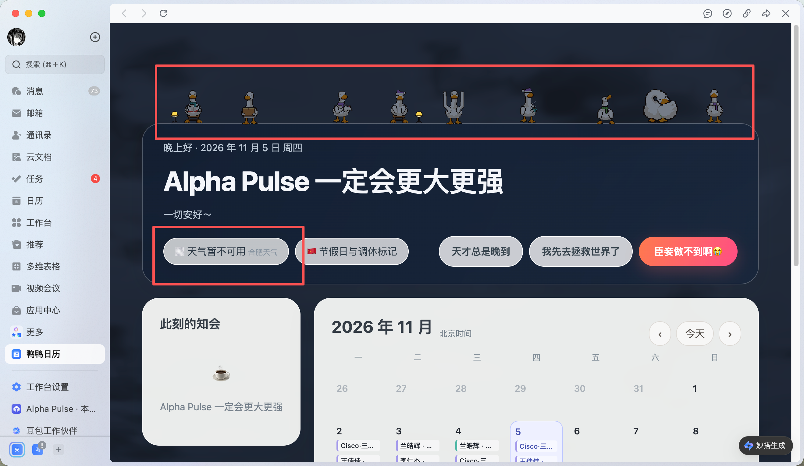

# 鸭鸭日历 v3.3.2｜天气实况兼容与鸭鸭动画修复

**更新日期：**2026 年 11 月 6 日  
**类型：**线上 Bug 修复与运行时降级优化。登记、Mentor/人事通知、日历读取和万圣节主题规则保持不变。  
**线上版本：**妙搭提交 `3582784284bf6a9eed89675a4d07495bbfd17534`；release `7704718438245649675`（finished）。

## 1. 问题表现

线上页面一度同时出现两个现象：天气胶囊显示“天气暂不可用”，顶部九只鸭鸭完全静止。截图中的灰色天气按钮和静止鸭鸭是修复前状态。

*图 1：修复前的线上状态；该图由真实反馈提供，登记数据为页面演示/历史数据。*

## 2. 根因定位

1. 天气服务实际接的是中央气象台合肥站实况接口 `nmc.cn/rest/weather?stationid=xqcji`。本次接口响应的发布时间、雨量、风速和风向均有效，但天气文字返回 `info:"-"`、图片码为 `9999`。
2. 服务端旧解析器只接受“晴/多云/阴/雨/雪”等文字，遇到单个缺失描述就抛出 `weather-condition-unknown`，把整条天气标成不可用。
3. 前端收到 `available:false` 后进入静态备用模式；鸭鸭动画与高开销背景共用同一个静态闸门，因此天气异常连带把鸭鸭帧循环停掉。浏览器本身并没有丢失鸭鸭素材。

## 3. 修改思路与实现

### 3.1 保留有效实况，给缺失描述安全降级

- 当中央气象台返回 `info:"-"` 或类似未知描述时，不再抛错。
- 雨量大于 0 时采用小雨场景，否则采用保守的阴天场景；同时保留真实发布时间、风速和风向。
- 页面继续显示“合肥天气”，只有请求失败、数据过期或结构校验失败时才显示“天气暂不可用”。

### 3.2 把鸭鸭动画与背景降级解耦

- WebGL 不可用或持续低帧率时，只降级背景天空和前景特效。
- 鸭鸭画布继续使用轻量帧循环；仅在用户开启系统“减少动态”、业务静态预览或审查暂停时停止。
- 保留原有低帧率降级、Canvas/DOM/PNG 兜底和上下文恢复策略，避免为恢复动画而牺牲正文可读性。

## 4. 验证与发布

- 本地单文件核验：布局 15 组（320/360/390/720/1440px × DPR 1/2/3）、阵风姿态、9 只鸭鸭 Canvas 降级与恢复、1,854 个美术组合均通过。
- 服务端与客户端 TypeScript 类型检查通过。
- 线上刷新后天气显示为“☁️ 阴 · 合肥天气”，帮助信息显示真实更新时间；运行时状态为 `WebGL · 30 FPS（目标 30）`。
- 线上截图在间隔 1.2 秒后产生约 98% 编码字节差异，确认页面帧循环持续刷新；不是只把静态图片重新绘制。
- 发布地址：[鸭鸭日历](https://ycn3zdw6f1p7.feishu.link/app/app_17fstqsqv1c)。

## 5. 工程记录

- 运行时修复提交：`16b47b1`（天气字段兼容）、`3582784`（动画与背景降级解耦）。
- 当前源文件 SHA-256：`0434e6d191ba99fcc822e75701fa94137e35f6f1c003e5514446f215365914f8`。
- 本轮未修改登记数据结构、通知对象解析或权限；变更范围限制在天气服务解析与视觉运行时调度。
