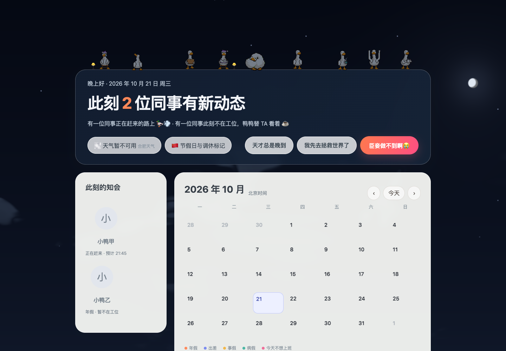

# 鸭鸭日历 v3.2.0｜知会状态与首屏体验

**更新日期：**2026 年 10 月 21 日

**状态：**飞书妙搭已发布；企业侧栏沿用原「鸭鸭日历」入口

**发布：**`7699099864667704593` · `6b79d325534d1c7c000757932cc9492b970c4a3c`

## 为什么要改

旧首页把“今天登记过的员工”直接作为“不在工位”人数。晚到知会即使设定了预计到达时间，也会被算进这句文案；到达时间过去后，首页仍可能保留过时的统计。它表达的是登记事实，却让读者误以为系统正在判断谁到岗，和团队只做知会、不做考勤的原则不符。

打开速度也受一个串行环节影响：页面先等鸭鸭插画接口返回，再创建日历画面。插画属于装饰，但接口慢时连日历正文都要等待。

## 修改思路与实现

1. **按此刻的知会分类。** 服务端提供与北京时间当天重叠的完整登记时段。页面按 `开始时间 ≤ 当前时间 < 结束时间` 计算，分别显示“正在赶来的路上”“此刻不在工位”“先去拯救世界了”。同一人若有重叠知会，只计一次；晚到结束后不再算作正在路上。
2. **到点自动更新。** 页面安排下一次登记边界的刷新，不依赖再次打开日历。主标题改为“此刻”的状态；没有进行中的知会时，只说“没有进行中的知会”，不推断所有人都在公司。
3. **先展示日历，再补插画。** 天空、卡片和操作入口先加载，鸭鸭素材异步取得后补齐。素材失败时仍可查看日历和登记知会。

*图：模拟数据验收画面，姓名为虚构示例。晚到和年假分开表述；这张图不代表实际员工状态或实时天气。*

## 验证与发布

- 28 项业务测试通过；涵盖晚到预计到达前后、请假与提前离开并存、同一人去重、通知对象与登记幂等。类型检查、Lint、前后端生产构建通过。
- 浏览器验证：素材接口尚未返回时日历已可显示；返回后九只鸭子补齐。模拟晚到时段结束后，页面自动从“2 位同事有新动态”变成只显示仍在请假的 1 位。
- 妙搭本次 release 已返回 `finished`，对应上方发布提交。企业侧栏入口保持不变；GitHub 的 `v3.2.0` Tag 指向同一已发布提交。

**后续观察：**继续对照飞书客户端的首次打开体验和 `/api/calendar/month` 延迟。当前改动消除了插画接口对首屏的阻塞；月度数据读取仍可能受多维表格接口耗时影响，不能把这次优化写成已量化的秒数提升。
